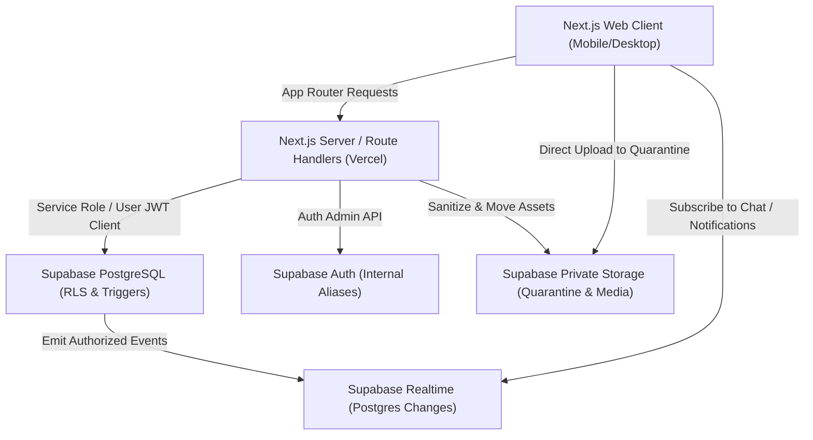
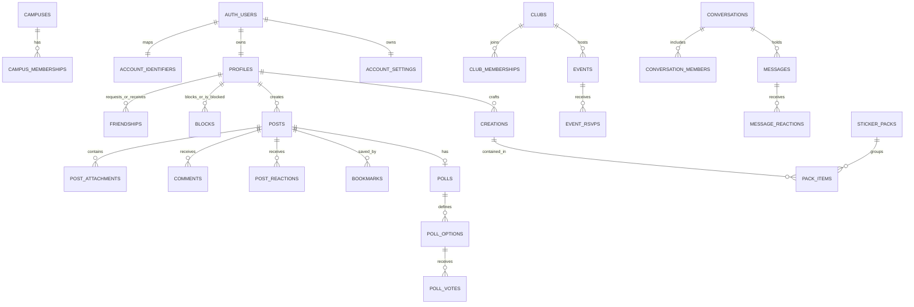
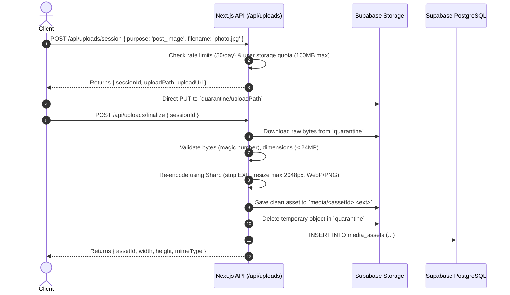
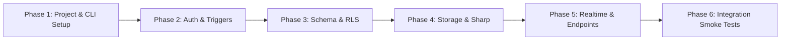

# Campus Connect — Backend Engineering Handoff & Architecture Guide

> **Target Audience:** Backend / Full-Stack Engineer  
> **Project:** Campus Connect (Mobile-First Social Web App for Christ University Lavasa)  
> **Primary Infrastructure:** Supabase (Auth, PostgreSQL, Storage, Realtime) + Next.js App Router (Node.js 24) on Vercel  
> **Source Baseline:** `IMPLEMENTATION_PLAN.md`  
> **Date:** October 2026  

---

## 1. Executive Summary & Architecture Overview

Campus Connect is a campus-scoped social platform for students aged 16+ at Christ University Lavasa. While the frontend is currently being built as a mobile-first, high-fidelity UI with local mock fixtures, this document outlines the **complete backend architecture, database schema, security rules, and API contracts** required for the production Supabase and Next.js backend implementation.

### Key Architecture Decisions
1. **Hosting & Compute:** Next.js (Node.js 24 runtime) hosted on **Vercel** (Mumbai region preferred).
2. **Database & Auth:** **Supabase PostgreSQL** with strict Row-Level Security (RLS) on every table and Supabase Auth with `@supabase/ssr`.
3. **Identity System:** Students sign up and log in using their **Registration Number** and password. No college email or admin roster verification is required. Accounts use an internal synthetic email alias system mapped inside Supabase Auth.
4. **Media Storage & Pipeline:** **Supabase Storage** with private buckets (`quarantine` and `media`). Files never route their full upload payload through Vercel functions; clients upload directly using presigned upload sessions, followed by server-side verification and sanitization with `sharp`.
5. **Real-Time Delivery:** Supabase **Realtime (Postgres Changes)** for active chat conversations and user notifications. Realtime delivers updates *only after* authoritative database persistence.
6. **No Heavy External Backends:** No custom Express server, Redis, microservices, or custom WebSocket servers. Everything is implemented using Supabase PostgreSQL primitives, Next.js Route Handlers / Server Actions, and Supabase client libraries.



---

## 2. Environment Variables & Secrets Reference

Create two environments: **Local/Staging** and **Production**.

| Variable Name | Exposure | Purpose / Description |
|---|---|---|
| `APP_ORIGIN` | Server | Application canonical URL (e.g., `http://localhost:3000` or `https://campusconnect.christ.ac.in`) |
| `NEXT_PUBLIC_SUPABASE_URL` | Public / Client | Supabase project URL (`https://<project-ref>.supabase.co`) |
| `NEXT_PUBLIC_SUPABASE_PUBLISHABLE_KEY` | Public / Client | Supabase publishable anonymous key (`anon` key) |
| `SUPABASE_SECRET_KEY` | **Server-Only** | Privileged Supabase service role key (for user provisioning & moderation) |
| `RATE_LIMIT_HMAC_SECRET` | **Server-Only** | Cryptographic secret for hashing client IP addresses into rate-limit buckets |
| `CRON_SECRET` | **Server-Only** | Bearer secret for authenticated Vercel cron endpoints (`/api/internal/maintenance`) |
| `NEXT_PUBLIC_GIPHY_FEED_KEY` | Public / Client | Client-side GIPHY SDK key for feed GIF/sticker picker |
| `NEXT_PUBLIC_GIPHY_CHAT_KEY` | Public / Client | Client-side GIPHY SDK key for chat picker |
| `NEXT_PUBLIC_GIPHY_STUDIO_KEY` | Public / Client | Client-side GIPHY SDK key for studio picker |
| `SIGNUPS_ENABLED` | Server / Config | Boolean flag (`true`/`false`) to gate open registrations during staged rollout |
| `GIF_ENABLED` | Server / Config | Feature toggle for provider GIF integrations |

> [!CAUTION]
> **Never** expose `SUPABASE_SECRET_KEY`, `RATE_LIMIT_HMAC_SECRET`, or `CRON_SECRET` to the client. All public clients must use the scoped `@supabase/ssr` browser client with the `anon` key.

---

## 3. Custom Registration-Number Authentication Architecture

Supabase Auth natively authenticates accounts using emails or phone numbers. To support registration-number logins without official college email integration, implement the following pattern:

### 3.1 Registration Number Normalization
All registration inputs must pass through a normalization function before queries or mutations:
```ts
export function normalizeRegistrationNumber(raw: string): string {
  const trimmed = raw.trim();
  // Accepts 4-32 alphanumeric characters and hyphens; keeps leading zeros intact
  if (!/^[A-Za-z0-9-]{4,32}$/.test(trimmed)) {
    throw new Error("Invalid registration number format.");
  }
  return trimmed.toUpperCase();
}
```

### 3.2 Internal Synthetic Email Alias
During registration, the backend generates an un-routable email under the reserved `.invalid` top-level domain:
```ts
function generateSyntheticEmail(normalizedRegNumber: string): string {
  // Example: reg_2441001@campusconnect.christlavasa.invalid
  return `reg_${normalizedRegNumber.toLowerCase()}@campusconnect.christlavasa.invalid`;
}
```

### 3.3 Account Signup Flow (`POST /api/auth/register`)
1. **Validation:** Check rate limits (5 per IP per hour), age confirmation (`>= 16`), and terms acceptance.
2. **Identifier Uniqueness:** Check `account_identifiers` table for existing `normalized_reg_number`. Reject if already registered.
3. **Create Supabase User:** Use the server-side privileged client (`supabaseAdmin.auth.admin.createUser`):
   ```ts
   const { data: user, error } = await supabaseAdmin.auth.admin.createUser({
     email: syntheticEmail,
     password: rawPassword,
     email_confirm: true, // Auto-confirm synthetic alias
     user_metadata: {
       normalized_reg_number: normalizedRegNumber,
     }
   });
   ```
4. **Database Provisioning Trigger:** A PostgreSQL `AFTER INSERT ON auth.users` trigger automatically inserts:
   - `account_identifiers (normalized_reg_number, user_id)`
   - `profiles (id, handle, display_name, avatar_url, ...)`
   - `account_settings (user_id)`
   - `campus_memberships (campus_id, user_id, status='active', role='student')`
5. **Establish Session:** Sign in via `supabase.auth.signInWithPassword({ email: syntheticEmail, password })` and set SSR cookies.

> [!IMPORTANT]
> Disable public signup in your Supabase Auth settings (`Enable Email Signup: false`) so that users cannot bypass the application's `/api/auth/register` endpoint.

### 3.4 Account Login Flow (`POST /api/auth/login`)
1. Normalize user-entered registration number.
2. Query `account_identifiers` (service-role query only) to find the matching `user_id`.
3. Fetch the user's current Supabase `email` using `supabaseAdmin.auth.admin.getUserById(userId)` (this supports accounts that later added a recovery email).
4. Call `supabase.auth.signInWithPassword({ email: currentEmail, password })`.
5. Verify `campus_memberships.status == 'active'` (reject banned/suspended users even if password matches).
6. Return the session cookie and profile payload.

### 3.5 Password Recovery Flow (`POST /api/auth/forgot-password` & Settings)
- **Adding Recovery Email:** In settings, a signed-in student can add a personal email. This calls Supabase Auth `updateUser({ email: newEmail })`.
- **Supabase Configuration:** Ensure "Secure email change" is disabled in Supabase Auth so only the *new* address receives a confirmation link (since the old synthetic alias cannot receive mail).
- **Password Reset:** When a user enters their registration number in `/forgot-password`, lookup their current email. If the email is still the `.invalid` alias, silently return a generic success message ("If a recovery email was registered, instructions were sent"). If a verified email exists, trigger Supabase's `resetPasswordForEmail()`.

---

## 4. Complete Database Schema & Migrations Guide

The schema uses standard PostgreSQL types with UUIDv4 primary keys, `timestamptz` timestamps, explicit foreign keys with `ON DELETE CASCADE` or `RESTRICT`, and granular `CHECK` constraints.

### 4.1 Domain Breakdown & Table Definitions



#### 1. Identity & Profile Tables
```sql
-- 1. Campuses
CREATE TABLE campuses (
    id UUID PRIMARY KEY DEFAULT gen_random_uuid(),
    name TEXT NOT NULL,
    slug TEXT NOT NULL UNIQUE,
    created_at TIMESTAMPTZ NOT NULL DEFAULT now()
);

-- Seed Christ Lavasa
INSERT INTO campuses (name, slug) VALUES ('Christ University Lavasa', 'christ-lavasa');

-- 2. Campus Memberships
CREATE TYPE campus_role AS ENUM ('student', 'moderator', 'campus_admin');
CREATE TYPE membership_status AS ENUM ('active', 'suspended', 'banned');

CREATE TABLE campus_memberships (
    id UUID PRIMARY KEY DEFAULT gen_random_uuid(),
    campus_id UUID NOT NULL REFERENCES campuses(id) ON DELETE CASCADE,
    user_id UUID NOT NULL REFERENCES auth.users(id) ON DELETE CASCADE,
    role campus_role NOT NULL DEFAULT 'student',
    status membership_status NOT NULL DEFAULT 'active',
    created_at TIMESTAMPTZ NOT NULL DEFAULT now(),
    updated_at TIMESTAMPTZ NOT NULL DEFAULT now(),
    UNIQUE (campus_id, user_id)
);

-- 3. Account Identifiers (Service-Role Only)
CREATE TABLE account_identifiers (
    normalized_reg_number TEXT PRIMARY KEY,
    user_id UUID NOT NULL UNIQUE REFERENCES auth.users(id) ON DELETE CASCADE,
    created_at TIMESTAMPTZ NOT NULL DEFAULT now()
);
ALTER TABLE account_identifiers ENABLE ROW LEVEL SECURITY;
-- No RLS policies granted for anon/authenticated (accessible only to service_role)

-- 4. Profiles
CREATE TABLE profiles (
    id UUID PRIMARY KEY REFERENCES auth.users(id) ON DELETE CASCADE,
    handle TEXT NOT NULL UNIQUE,
    display_name TEXT NOT NULL,
    avatar_url TEXT,
    bio VARCHAR(160),
    course TEXT,
    year_of_study INT CHECK (year_of_study BETWEEN 1 AND 5),
    interests TEXT[] DEFAULT '{}',
    created_at TIMESTAMPTZ NOT NULL DEFAULT now(),
    updated_at TIMESTAMPTZ NOT NULL DEFAULT now(),
    CONSTRAINT valid_handle CHECK (handle ~ '^[a-z0-9_]{3,24}$')
);
CREATE INDEX idx_profiles_handle ON profiles(handle);
CREATE INDEX idx_profiles_display_name ON profiles(display_name);

-- 5. Account Settings
CREATE TABLE account_settings (
    user_id UUID PRIMARY KEY REFERENCES auth.users(id) ON DELETE CASCADE,
    theme TEXT NOT NULL DEFAULT 'light' CHECK (theme IN ('light', 'dark', 'system')),
    reduce_motion BOOLEAN NOT NULL DEFAULT false,
    read_receipts_enabled BOOLEAN NOT NULL DEFAULT false,
    notify_on_comments BOOLEAN NOT NULL DEFAULT true,
    notify_on_reactions BOOLEAN NOT NULL DEFAULT true,
    notify_on_friend_requests BOOLEAN NOT NULL DEFAULT true,
    updated_at TIMESTAMPTZ NOT NULL DEFAULT now()
);
```

#### 2. Relationships & Moderation Safety
```sql
-- 6. Friendships
CREATE TYPE friendship_status AS ENUM ('pending', 'accepted', 'rejected');

CREATE TABLE friendships (
    id UUID PRIMARY KEY DEFAULT gen_random_uuid(),
    requester_id UUID NOT NULL REFERENCES auth.users(id) ON DELETE CASCADE,
    addressee_id UUID NOT NULL REFERENCES auth.users(id) ON DELETE CASCADE,
    status friendship_status NOT NULL DEFAULT 'pending',
    created_at TIMESTAMPTZ NOT NULL DEFAULT now(),
    updated_at TIMESTAMPTZ NOT NULL DEFAULT now(),
    CONSTRAINT no_self_friendship CHECK (requester_id <> addressee_id),
    -- Ensure only one direction or record can exist between two users
    CONSTRAINT unique_friendship_pair UNIQUE (
        LEAST(requester_id, addressee_id),
        GREATEST(requester_id, addressee_id)
    )
);
CREATE INDEX idx_friendships_users ON friendships(requester_id, addressee_id);

-- 7. Blocks
CREATE TABLE blocks (
    blocker_id UUID NOT NULL REFERENCES auth.users(id) ON DELETE CASCADE,
    blocked_id UUID NOT NULL REFERENCES auth.users(id) ON DELETE CASCADE,
    created_at TIMESTAMPTZ NOT NULL DEFAULT now(),
    PRIMARY KEY (blocker_id, blocked_id),
    CONSTRAINT no_self_block CHECK (blocker_id <> blocked_id)
);
CREATE INDEX idx_blocks_lookup ON blocks(blocker_id, blocked_id);

-- 8. Reports & Moderation Actions
CREATE TYPE report_category AS ENUM ('harassment', 'impersonation', 'sexual_content', 'hate', 'spam', 'copyright', 'other');
CREATE TYPE report_status AS ENUM ('pending', 'reviewed', 'actioned', 'dismissed');

CREATE TABLE reports (
    id UUID PRIMARY KEY DEFAULT gen_random_uuid(),
    reporter_id UUID NOT NULL REFERENCES auth.users(id) ON DELETE CASCADE,
    category report_category NOT NULL,
    notes TEXT,
    target_type TEXT NOT NULL CHECK (target_type IN ('profile', 'post', 'comment', 'message', 'pack')),
    target_id UUID NOT NULL,
    status report_status NOT NULL DEFAULT 'pending',
    created_at TIMESTAMPTZ NOT NULL DEFAULT now()
);

CREATE TABLE moderation_actions (
    id UUID PRIMARY KEY DEFAULT gen_random_uuid(),
    moderator_id UUID NOT NULL REFERENCES auth.users(id) ON DELETE CASCADE,
    report_id UUID REFERENCES reports(id) ON DELETE SET NULL,
    action TEXT NOT NULL CHECK (action IN ('warn', 'remove_content', 'suspend_user', 'ban_user', 'dismiss')),
    reason TEXT NOT NULL,
    target_user_id UUID REFERENCES auth.users(id) ON DELETE CASCADE,
    created_at TIMESTAMPTZ NOT NULL DEFAULT now()
);
```

#### 3. Feed, Polls, Posts & Comments
```sql
-- 9. Posts
CREATE TABLE posts (
    id UUID PRIMARY KEY DEFAULT gen_random_uuid(),
    author_id UUID NOT NULL REFERENCES auth.users(id) ON DELETE CASCADE,
    campus_id UUID NOT NULL REFERENCES campuses(id) ON DELETE CASCADE,
    club_id UUID REFERENCES clubs(id) ON DELETE CASCADE, -- Optional: club-specific post
    content VARCHAR(2000),
    is_pinned BOOLEAN NOT NULL DEFAULT false,
    created_at TIMESTAMPTZ NOT NULL DEFAULT now(),
    updated_at TIMESTAMPTZ NOT NULL DEFAULT now()
);
CREATE INDEX idx_posts_campus_created ON posts(campus_id, created_at DESC);
CREATE INDEX idx_posts_author ON posts(author_id);

-- 10. Post Attachments
CREATE TYPE attachment_kind AS ENUM ('image', 'custom_sticker', 'giphy');

CREATE TABLE post_attachments (
    id UUID PRIMARY KEY DEFAULT gen_random_uuid(),
    post_id UUID NOT NULL REFERENCES posts(id) ON DELETE CASCADE,
    kind attachment_kind NOT NULL,
    media_asset_id UUID REFERENCES media_assets(id) ON DELETE CASCADE,
    creation_id UUID REFERENCES creations(id) ON DELETE CASCADE,
    giphy_id TEXT,
    giphy_kind TEXT CHECK (giphy_kind IN ('gif', 'sticker')),
    display_order INT NOT NULL DEFAULT 0,
    created_at TIMESTAMPTZ NOT NULL DEFAULT now()
);

-- 11. Comments
CREATE TABLE comments (
    id UUID PRIMARY KEY DEFAULT gen_random_uuid(),
    post_id UUID NOT NULL REFERENCES posts(id) ON DELETE CASCADE,
    author_id UUID NOT NULL REFERENCES auth.users(id) ON DELETE CASCADE,
    content VARCHAR(1000) NOT NULL,
    parent_comment_id UUID REFERENCES comments(id) ON DELETE CASCADE,
    created_at TIMESTAMPTZ NOT NULL DEFAULT now()
);
CREATE INDEX idx_comments_post ON comments(post_id, created_at ASC);

-- 12. Post Reactions (Restricted fixed set: like, love, laugh, fire, clap)
CREATE TABLE post_reactions (
    post_id UUID NOT NULL REFERENCES posts(id) ON DELETE CASCADE,
    user_id UUID NOT NULL REFERENCES auth.users(id) ON DELETE CASCADE,
    reaction TEXT NOT NULL CHECK (reaction IN ('like', 'love', 'laugh', 'fire', 'clap')),
    created_at TIMESTAMPTZ NOT NULL DEFAULT now(),
    PRIMARY KEY (post_id, user_id)
);

-- 13. Bookmarks
CREATE TABLE bookmarks (
    user_id UUID NOT NULL REFERENCES auth.users(id) ON DELETE CASCADE,
    post_id UUID NOT NULL REFERENCES posts(id) ON DELETE CASCADE,
    created_at TIMESTAMPTZ NOT NULL DEFAULT now(),
    PRIMARY KEY (user_id, post_id)
);

-- 14. Polls & Votes
CREATE TABLE polls (
    id UUID PRIMARY KEY DEFAULT gen_random_uuid(),
    post_id UUID NOT NULL UNIQUE REFERENCES posts(id) ON DELETE CASCADE,
    question TEXT NOT NULL,
    closes_at TIMESTAMPTZ NOT NULL,
    created_at TIMESTAMPTZ NOT NULL DEFAULT now()
);

CREATE TABLE poll_options (
    id UUID PRIMARY KEY DEFAULT gen_random_uuid(),
    poll_id UUID NOT NULL REFERENCES polls(id) ON DELETE CASCADE,
    option_text TEXT NOT NULL,
    display_order INT NOT NULL
);

CREATE TABLE poll_votes (
    poll_id UUID NOT NULL REFERENCES polls(id) ON DELETE CASCADE,
    user_id UUID NOT NULL REFERENCES auth.users(id) ON DELETE CASCADE,
    option_id UUID NOT NULL REFERENCES poll_options(id) ON DELETE CASCADE,
    created_at TIMESTAMPTZ NOT NULL DEFAULT now(),
    updated_at TIMESTAMPTZ NOT NULL DEFAULT now(),
    PRIMARY KEY (poll_id, user_id)
);
```

#### 4. Clubs & Events
```sql
-- 15. Clubs
CREATE TABLE clubs (
    id UUID PRIMARY KEY DEFAULT gen_random_uuid(),
    campus_id UUID NOT NULL REFERENCES campuses(id) ON DELETE CASCADE,
    name TEXT NOT NULL,
    slug TEXT NOT NULL UNIQUE,
    description TEXT NOT NULL,
    cover_image_url TEXT,
    category TEXT NOT NULL,
    owner_id UUID NOT NULL REFERENCES auth.users(id) ON DELETE RESTRICT,
    created_at TIMESTAMPTZ NOT NULL DEFAULT now()
);

CREATE TYPE club_role AS ENUM ('member', 'organizer', 'owner');

CREATE TABLE club_memberships (
    club_id UUID NOT NULL REFERENCES clubs(id) ON DELETE CASCADE,
    user_id UUID NOT NULL REFERENCES auth.users(id) ON DELETE CASCADE,
    role club_role NOT NULL DEFAULT 'member',
    joined_at TIMESTAMPTZ NOT NULL DEFAULT now(),
    PRIMARY KEY (club_id, user_id)
);

-- 16. Events
CREATE TABLE events (
    id UUID PRIMARY KEY DEFAULT gen_random_uuid(),
    club_id UUID REFERENCES clubs(id) ON DELETE CASCADE,
    campus_id UUID NOT NULL REFERENCES campuses(id) ON DELETE CASCADE,
    creator_id UUID NOT NULL REFERENCES auth.users(id) ON DELETE RESTRICT,
    title TEXT NOT NULL,
    description TEXT NOT NULL,
    cover_image_url TEXT,
    starts_at TIMESTAMPTZ NOT NULL,
    ends_at TIMESTAMPTZ NOT NULL,
    venue TEXT NOT NULL,
    external_url TEXT,
    is_cancelled BOOLEAN NOT NULL DEFAULT false,
    created_at TIMESTAMPTZ NOT NULL DEFAULT now(),
    CONSTRAINT valid_times CHECK (ends_at > starts_at)
);

CREATE TYPE rsvp_status AS ENUM ('going', 'interested');

CREATE TABLE event_rsvps (
    event_id UUID NOT NULL REFERENCES events(id) ON DELETE CASCADE,
    user_id UUID NOT NULL REFERENCES auth.users(id) ON DELETE CASCADE,
    status rsvp_status NOT NULL,
    created_at TIMESTAMPTZ NOT NULL DEFAULT now(),
    PRIMARY KEY (event_id, user_id)
);
```

#### 5. Real-Time Chat & Direct Messaging
```sql
-- 17. Conversations
CREATE TYPE conversation_type AS ENUM ('direct', 'group');

CREATE TABLE conversations (
    id UUID PRIMARY KEY DEFAULT gen_random_uuid(),
    type conversation_type NOT NULL,
    title TEXT, -- For groups
    creator_id UUID NOT NULL REFERENCES auth.users(id) ON DELETE RESTRICT,
    last_message_at TIMESTAMPTZ NOT NULL DEFAULT now(),
    created_at TIMESTAMPTZ NOT NULL DEFAULT now()
);

-- Direct pair uniqueness helper table or constraint:
CREATE TABLE direct_conversation_pairs (
    user_one UUID NOT NULL REFERENCES auth.users(id) ON DELETE CASCADE,
    user_two UUID NOT NULL REFERENCES auth.users(id) ON DELETE CASCADE,
    conversation_id UUID NOT NULL REFERENCES conversations(id) ON DELETE CASCADE,
    PRIMARY KEY (user_one, user_two),
    CONSTRAINT canonical_pair CHECK (user_one < user_two)
);

-- 18. Conversation Members
CREATE TYPE member_invite_status AS ENUM ('pending', 'accepted', 'left', 'removed');

CREATE TABLE conversation_members (
    conversation_id UUID NOT NULL REFERENCES conversations(id) ON DELETE CASCADE,
    user_id UUID NOT NULL REFERENCES auth.users(id) ON DELETE CASCADE,
    role TEXT NOT NULL DEFAULT 'member' CHECK (role IN ('member', 'admin')),
    status member_invite_status NOT NULL DEFAULT 'accepted',
    last_read_at TIMESTAMPTZ NOT NULL DEFAULT now(),
    joined_at TIMESTAMPTZ NOT NULL DEFAULT now(),
    PRIMARY KEY (conversation_id, user_id)
);
CREATE INDEX idx_conversation_members_user ON conversation_members(user_id, status);

-- 19. Messages
CREATE TABLE messages (
    id UUID PRIMARY KEY DEFAULT gen_random_uuid(),
    conversation_id UUID NOT NULL REFERENCES conversations(id) ON DELETE CASCADE,
    sender_id UUID NOT NULL REFERENCES auth.users(id) ON DELETE CASCADE,
    content VARCHAR(4000),
    attachment_kind attachment_kind,
    media_asset_id UUID REFERENCES media_assets(id) ON DELETE SET NULL,
    creation_id UUID REFERENCES creations(id) ON DELETE SET NULL,
    giphy_id TEXT,
    created_at TIMESTAMPTZ NOT NULL DEFAULT now(),
    is_deleted BOOLEAN NOT NULL DEFAULT false,
    CONSTRAINT message_has_content CHECK (
        content IS NOT NULL OR attachment_kind IS NOT NULL
    )
);
CREATE INDEX idx_messages_conv_created ON messages(conversation_id, created_at DESC);

-- 20. Message Reactions
CREATE TABLE message_reactions (
    message_id UUID NOT NULL REFERENCES messages(id) ON DELETE CASCADE,
    user_id UUID NOT NULL REFERENCES auth.users(id) ON DELETE CASCADE,
    emoji TEXT NOT NULL,
    created_at TIMESTAMPTZ NOT NULL DEFAULT now(),
    PRIMARY KEY (message_id, user_id)
);
```

#### 6. Creations, Sticker Studio & Media Assets
```sql
-- 21. Media Assets (Processed files in Supabase Storage)
CREATE TABLE media_assets (
    id UUID PRIMARY KEY DEFAULT gen_random_uuid(),
    uploader_id UUID NOT NULL REFERENCES auth.users(id) ON DELETE CASCADE,
    storage_path TEXT NOT NULL UNIQUE,
    bucket TEXT NOT NULL DEFAULT 'media',
    byte_size INT NOT NULL,
    mime_type TEXT NOT NULL,
    width INT NOT NULL,
    height INT NOT NULL,
    purpose TEXT NOT NULL CHECK (purpose IN ('avatar', 'post_image', 'sticker', 'meme', 'club_cover', 'event_cover')),
    created_at TIMESTAMPTZ NOT NULL DEFAULT now()
);

-- 22. Creations (Studio Memes & Stickers)
CREATE TYPE creation_kind AS ENUM ('meme', 'sticker');

CREATE TABLE creations (
    id UUID PRIMARY KEY DEFAULT gen_random_uuid(),
    creator_id UUID NOT NULL REFERENCES auth.users(id) ON DELETE CASCADE,
    kind creation_kind NOT NULL,
    title TEXT NOT NULL,
    draft_data JSONB NOT NULL DEFAULT '{}'::jsonb, -- Canvas layers, texts, polygons
    rendered_asset_id UUID REFERENCES media_assets(id) ON DELETE SET NULL,
    is_published BOOLEAN NOT NULL DEFAULT false,
    created_at TIMESTAMPTZ NOT NULL DEFAULT now(),
    updated_at TIMESTAMPTZ NOT NULL DEFAULT now()
);

-- 23. Sticker Packs
CREATE TABLE sticker_packs (
    id UUID PRIMARY KEY DEFAULT gen_random_uuid(),
    creator_id UUID NOT NULL REFERENCES auth.users(id) ON DELETE CASCADE,
    title TEXT NOT NULL,
    cover_creation_id UUID REFERENCES creations(id) ON DELETE SET NULL,
    is_published BOOLEAN NOT NULL DEFAULT false,
    created_at TIMESTAMPTZ NOT NULL DEFAULT now(),
    updated_at TIMESTAMPTZ NOT NULL DEFAULT now()
);

CREATE TABLE pack_items (
    pack_id UUID NOT NULL REFERENCES sticker_packs(id) ON DELETE CASCADE,
    creation_id UUID NOT NULL REFERENCES creations(id) ON DELETE CASCADE,
    display_order INT NOT NULL DEFAULT 0,
    PRIMARY KEY (pack_id, creation_id)
);

CREATE TABLE saved_packs (
    user_id UUID NOT NULL REFERENCES auth.users(id) ON DELETE CASCADE,
    pack_id UUID NOT NULL REFERENCES sticker_packs(id) ON DELETE CASCADE,
    saved_at TIMESTAMPTZ NOT NULL DEFAULT now(),
    PRIMARY KEY (user_id, pack_id)
);
```

#### 7. Notifications & Rate Limiting
```sql
-- 24. Notifications
CREATE TYPE notification_type AS ENUM (
    'friend_request', 'friend_accept', 'comment', 'reaction',
    'group_invite', 'message', 'event_update', 'moderation'
);

CREATE TABLE notifications (
    id UUID PRIMARY KEY DEFAULT gen_random_uuid(),
    recipient_id UUID NOT NULL REFERENCES auth.users(id) ON DELETE CASCADE,
    actor_id UUID REFERENCES auth.users(id) ON DELETE CASCADE,
    type notification_type NOT NULL,
    destination_url TEXT NOT NULL,
    title TEXT NOT NULL,
    body TEXT,
    is_read BOOLEAN NOT NULL DEFAULT false,
    dedup_key TEXT, -- Prevents spamming duplicate alerts
    created_at TIMESTAMPTZ NOT NULL DEFAULT now()
);
CREATE INDEX idx_notifications_recipient ON notifications(recipient_id, created_at DESC);

-- 25. Rate Limit Buckets
CREATE TABLE rate_limit_buckets (
    bucket_key TEXT PRIMARY KEY, -- HMAC hash of IP + route
    tokens INT NOT NULL,
    last_replenished_at TIMESTAMPTZ NOT NULL DEFAULT now()
);
```

---

## 5. Row-Level Security (RLS) & Access Control Matrix

Every table must have `ALTER TABLE <table> ENABLE ROW LEVEL SECURITY;`.

### 5.1 Security Helper Functions
Create these reusable SQL helper functions in a dedicated schema or `public` with `SECURITY DEFINER` and fixed `search_path = public`:

```sql
-- 1. Check if user is active member of Christ Lavasa
CREATE OR REPLACE FUNCTION is_active_student(uid UUID)
RETURNS BOOLEAN
LANGUAGE sql
SECURITY DEFINER
SET search_path = public
AS $$
  SELECT EXISTS (
    SELECT 1 FROM campus_memberships
    WHERE user_id = uid AND status = 'active'
  );
$$;

-- 2. Check if two users have blocked each other
CREATE OR REPLACE FUNCTION are_blocked(uid_a UUID, uid_b UUID)
RETURNS BOOLEAN
LANGUAGE sql
SECURITY DEFINER
SET search_path = public
AS $$
  SELECT EXISTS (
    SELECT 1 FROM blocks
    WHERE (blocker_id = uid_a AND blocked_id = uid_b)
       OR (blocker_id = uid_b AND blocked_id = uid_a)
  );
$$;

-- 3. Check if two users are mutual friends
CREATE OR REPLACE FUNCTION are_friends(uid_a UUID, uid_b UUID)
RETURNS BOOLEAN
LANGUAGE sql
SECURITY DEFINER
SET search_path = public
AS $$
  SELECT EXISTS (
    SELECT 1 FROM friendships
    WHERE status = 'accepted'
      AND ((requester_id = uid_a AND addressee_id = uid_b)
        OR (requester_id = uid_b AND addressee_id = uid_a))
  );
$$;

-- 4. Check if user is an accepted member of a conversation
CREATE OR REPLACE FUNCTION is_conversation_member(conv_id UUID, uid UUID)
RETURNS BOOLEAN
LANGUAGE sql
SECURITY DEFINER
SET search_path = public
AS $$
  SELECT EXISTS (
    SELECT 1 FROM conversation_members
    WHERE conversation_id = conv_id AND user_id = uid AND status = 'accepted'
  );
$$;
```

### 5.2 RLS Policy Directives

| Table | SELECT Policy | INSERT Policy | UPDATE Policy | DELETE Policy |
|---|---|---|---|---|
| `profiles` | Active students where `NOT are_blocked(auth.uid(), id)` | Trigger only (`auth.uid() = id`) | `auth.uid() = id` (display name, bio, avatar, course, year, interests) | Admin only |
| `account_settings` | `auth.uid() = user_id` | `auth.uid() = user_id` | `auth.uid() = user_id` | `auth.uid() = user_id` |
| `friendships` | User is either `requester_id` or `addressee_id` | User is `requester_id` AND `is_active_student(auth.uid())` | User is either party (accept/reject) | User is either party |
| `blocks` | `auth.uid() = blocker_id` | `auth.uid() = blocker_id` | None | `auth.uid() = blocker_id` |
| `posts` | `is_active_student(auth.uid())` AND `NOT are_blocked(auth.uid(), author_id)` | `auth.uid() = author_id` AND `is_active_student(auth.uid())` | `auth.uid() = author_id` | `auth.uid() = author_id` OR campus admin |
| `comments` | Can view parent post AND `NOT are_blocked(auth.uid(), author_id)` | `auth.uid() = author_id` AND can view parent post | `auth.uid() = author_id` | `auth.uid() = author_id` OR post author |
| `post_reactions`| Can view post | `auth.uid() = user_id` AND can view post | `auth.uid() = user_id` | `auth.uid() = user_id` |
| `bookmarks` | `auth.uid() = user_id` | `auth.uid() = user_id` | None | `auth.uid() = user_id` |
| `conversations`| User has accepted membership in the conversation | Active student creating direct or group conversation | Group admin can update title/details | Group admin or creator |
| `conversation_members` | User is an accepted member of that conversation | Group creator or mutual friend inviter | User updates own `last_read_at` or status | Self leave OR group admin remove |
| `messages` | `is_conversation_member(conversation_id, auth.uid())` AND `NOT are_blocked(auth.uid(), sender_id)` | `auth.uid() = sender_id` AND `is_conversation_member(conversation_id, auth.uid())` | Sender updates `is_deleted = true` | Sender only |
| `creations` | `auth.uid() = creator_id` OR `is_published = true` | `auth.uid() = creator_id` | `auth.uid() = creator_id` | `auth.uid() = creator_id` |
| `sticker_packs`| `auth.uid() = creator_id` OR `is_published = true` | `auth.uid() = creator_id` | `auth.uid() = creator_id` | `auth.uid() = creator_id` |
| `notifications`| `auth.uid() = recipient_id` | Service role or system trigger only | `auth.uid() = recipient_id` (mark read) | `auth.uid() = recipient_id` |

---

## 6. Storage Buckets & Media Processing Pipeline

### 6.1 Buckets Configuration
1. **`quarantine` Bucket:**
   - **Privacy:** Private.
   - **Purpose:** Temporary holding area for raw uploads directly from the client.
   - **Upload permissions:** Authenticated active students can upload files strictly into `<auth.uid()>/<session_id>.<ext>`.
   - **Retention:** Files automatically cleared after 2 hours if not finalized.
2. **`media` Bucket:**
   - **Privacy:** Private.
   - **Purpose:** Final sanitized assets (avatars, post images, memes, transparent stickers).
   - **Access control:** Access is granted via short-lived signed URLs (5-minute TTL) generated by the server after verifying permission on the enclosing post, message, or profile.

### 6.2 Upload & Sanitization Sequence


### 6.3 Media Sanitization Specifications (using `sharp`)
```ts
import sharp from "sharp";

export async function sanitizeImage(buffer: Buffer, purpose: string) {
  const metadata = await sharp(buffer).metadata();

  // 1. Validate dimensions
  if (!metadata.width || !metadata.height) throw new Error("Invalid image");
  if (metadata.width * metadata.height > 24_000_000) {
    throw new Error("Image exceeds 24 megapixel limit");
  }

  // 2. Transform based on purpose
  let pipeline = sharp(buffer).rotate(); // auto-rotate based on EXIF before stripping

  if (purpose === "sticker") {
    // Preserve alpha, resize to 512x512
    return pipeline
      .resize(512, 512, { fit: "inside", withoutEnlargement: true })
      .png({ compressionLevel: 9 })
      .toBuffer();
  } else if (purpose === "avatar") {
    return pipeline
      .resize(512, 512, { fit: "cover" })
      .webp({ quality: 85 })
      .toBuffer();
  } else {
    // General post image / meme
    return pipeline
      .resize(2048, 2048, { fit: "inside", withoutEnlargement: true })
      .webp({ quality: 85 })
      .toBuffer();
  }
}
```

---

## 7. Supabase Realtime Configuration

Enable Supabase Realtime (Postgres Changes) on the following tables:
1. `messages`
2. `message_reactions`
3. `notifications`
4. `conversation_members`

### 7.1 Realtime Publication Setup
```sql
-- Add tables to the supabase_realtime publication
ALTER PUBLICATION supabase_realtime ADD TABLE messages;
ALTER PUBLICATION supabase_realtime ADD TABLE message_reactions;
ALTER PUBLICATION supabase_realtime ADD TABLE notifications;
ALTER PUBLICATION supabase_realtime ADD TABLE conversation_members;
```

### 7.2 Client Subscription Filter Rules
- **Chat:** The client subscribes only to messages for the *currently open* conversation:
  ```ts
  supabase
    .channel(`room:${conversationId}`)
    .on(
      'postgres_changes',
      {
        event: 'INSERT',
        schema: 'public',
        table: 'messages',
        filter: `conversation_id=eq.${conversationId}`
      },
      (payload) => handleNewMessage(payload.new)
    )
    .subscribe();
  ```
- **Notifications:** The client subscribes only to their own notifications:
  ```ts
  supabase
    .channel(`user-notifications:${userId}`)
    .on(
      'postgres_changes',
      {
        event: 'INSERT',
        schema: 'public',
        table: 'notifications',
        filter: `recipient_id=eq.${userId}`
      },
      (payload) => handleNewNotification(payload.new)
    )
    .subscribe();
  ```

---

## 8. API Route Specifications & Data Contracts

All endpoints live under `/api/*`. Standardized JSON envelopes are required.

### 8.1 Standard Envelope Types

```ts
// Standard Error Response Envelope
export type ApiError = {
  error: {
    code: "BAD_REQUEST" | "UNAUTHORIZED" | "FORBIDDEN" | "NOT_FOUND" | "CONFLICT" | "RATE_LIMITED" | "INTERNAL_SERVER_ERROR";
    message: string;
    fieldErrors?: Record<string, string[]>;
    retryAfterSeconds?: number;
  };
};

// Standard Cursor-Paginated Response Envelope
export type Page<T> = {
  items: T[];
  nextCursor: string | null;
};
```

### 8.2 Endpoint Inventory

| Endpoint | Method | Auth Required | Purpose / Request Shape |
|---|---|---|---|
| `/api/auth/register` | `POST` | No | `{ regNumber, password, confirmPassword, isAgeConfirmed, termsAccepted }` |
| `/api/auth/login` | `POST` | No | `{ regNumber, password }` |
| `/api/auth/logout` | `POST` | Yes | Clears session cookies |
| `/api/auth/recovery` | `POST` | No | `{ regNumber }` (requests password reset) |
| `/api/profile` | `GET` / `PATCH` | Yes | Get or update profile (`displayName`, `avatarUrl`, `bio`, `course`, `year`, `interests`) |
| `/api/profile/settings` | `GET` | `PATCH` | Yes | Update themes, motion, read receipts, notification toggles |
| `/api/feed` | `GET` | Yes | Query params: `tab=('campus'\|'friends'\|'clubs')`, `cursor`, `limit=20` |
| `/api/posts` | `POST` | Yes | `{ content, attachments: AttachmentInput[], poll?: PollInput }` |
| `/api/posts/[id]` | `GET` / `DELETE` / `PATCH` | Yes | Fetch details, delete post, or edit post content |
| `/api/posts/[id]/comments` | `GET` / `POST` | Yes | List comments or post new comment `{ content, parentCommentId? }` |
| `/api/posts/[id]/reactions` | `POST` / `DELETE` | Yes | Add reaction `{ reaction: 'like'\|'love'\|... }` or remove reaction |
| `/api/posts/[id]/bookmark` | `POST` / `DELETE` | Yes | Toggle post bookmark |
| `/api/polls/[id]/vote` | `POST` | Yes | `{ optionId }` |
| `/api/friends/request` | `POST` | Yes | `{ targetUserId }` |
| `/api/friends/respond` | `POST` | Yes | `{ friendshipId, action: 'accept'\|'reject' }` |
| `/api/friends/remove` | `POST` | Yes | `{ friendUserId }` |
| `/api/blocks` | `POST` / `DELETE` | Yes | Block user `{ targetUserId }` or unblock |
| `/api/conversations` | `GET` / `POST` | Yes | List conversations or start a direct/group chat `{ type, friendUserId?, title?, inviteeIds? }` |
| `/api/conversations/[id]/messages`| `GET` / `POST` | Yes | Paginate messages (`cursor`) or send message `{ id: uuid, content, attachment? }` |
| `/api/conversations/[id]/read`| `POST` | Yes | Mark conversation up to message ID as read |
| `/api/clubs` | `GET` / `POST` | Yes | List clubs or create student club `{ name, description, category, coverUrl }` |
| `/api/clubs/[id]/join` | `POST` / `DELETE` | Yes | Join or leave club |
| `/api/events` | `GET` / `POST` | Yes | List events or create event `{ title, startsAt, endsAt, venue, clubId? }` |
| `/api/events/[id]/rsvp` | `POST` / `DELETE` | Yes | RSVP `{ status: 'going'\|'interested' }` |
| `/api/uploads/session` | `POST` | Yes | Create upload session `{ purpose, filename, byteSize }` |
| `/api/uploads/finalize` | `POST` | Yes | Finalize upload `{ sessionId }` |
| `/api/creations` | `GET` / `POST` | Yes | List owned creations or save studio draft `{ kind, title, draftData, assetId? }` |
| `/api/packs` | `GET` / `POST` | Yes | Discover packs or publish new pack `{ title, coverCreationId, creationIds }` |
| `/api/notifications` | `GET` / `PATCH` | Yes | Get notifications or mark all/selected as read |
| `/api/reports` | `POST` | Yes | Submit safety report `{ targetType, targetId, category, notes }` |
| `/api/internal/maintenance` | `POST` | Bearer Token | Cron task: cleanup abandoned quarantine uploads & process account deletions |

---

## 9. Rate Limiting, Abuse Prevention & Cron Jobs

### 9.1 Rate Limits (Enforced per IP / Account)
- **Signups:** Max 5 per IP per hour.
- **Logins:** Max 30 attempts per IP per 15 minutes.
- **Password Recovery:** Max 3 per registration number per hour.
- **Feed Posts:** Max 10 per user per hour.
- **Comments:** Max 60 per user per hour.
- **Direct Messages:** Max 60 per user per minute.
- **Media Uploads:** Max 50 attempts per user per 24 hours.

### 9.2 Daily Maintenance Cron Job (`/api/internal/maintenance`)
Triggered via Vercel Cron or Supabase `pg_cron` with header `Authorization: Bearer <CRON_SECRET>`:
1. **Purge Abandoned Uploads:** Identify objects in `quarantine` bucket older than 2 hours without a finalized `media_assets` record and delete them.
2. **Process Pending Account Deletions:** Delete Storage objects owned by users scheduled for deletion, remove their database records, and invoke `supabaseAdmin.auth.admin.deleteUser()`.
3. **Prune Rate Limit Buckets:** Delete bucket rows with `last_replenished_at < now() - INTERVAL '24 hours'`.

---

## 10. Step-by-Step Implementation Roadmap for Backend Dev



### Phase 1: Local Supabase & CLI Setup
1. Initialize local Supabase using `npx supabase init`.
2. Start the local stack using `npx supabase start`.
3. Verify connection details and populate local `.env.local`.

### Phase 2: Auth Checkpoint & Provisioning Triggers (P03)
1. Write the initial migration `00001_auth_provisioning.sql` creating `campuses`, `campus_memberships`, `account_identifiers`, `profiles`, and `account_settings`.
2. Implement the `handle_new_user` trigger on `auth.users`.
3. Scaffold `/api/auth/register` and `/api/auth/login` using `@supabase/ssr` and `supabaseAdmin`.
4. Test:
   - Immediate signup with a registration number (e.g. `2441001`).
   - Normalization (e.g., `2441001` vs ` 2441001 `).
   - Duplicate signup rejection (must return `409 Conflict`).
   - Logout and login with the same credentials.

### Phase 3: Core Social Schema & RLS Policies (P04)
1. Apply migrations for `friendships`, `blocks`, `posts`, `comments`, `reactions`, `polls`, `clubs`, and `events`.
2. Enable RLS and add the helper functions (`is_active_student`, `are_blocked`, `are_friends`).
3. Write pgTAP or Vitest unit tests verifying that blocked users cannot view each other's posts.

### Phase 4: Storage & Media Processing (P06)
1. Create `quarantine` and `media` private buckets in Supabase Storage.
2. Configure bucket RLS policies.
3. Install `sharp` and build `/api/uploads/session` and `/api/uploads/finalize`.
4. Test: Uploading a valid image, oversized image rejection, and sanitization/EXIF stripping.

### Phase 5: Chat, Realtime & Remaining Route Handlers (P08-P12)
1. Apply `conversations`, `conversation_members`, and `messages` tables with RLS.
2. Enable Postgres Changes on `messages` and `notifications`.
3. Implement cursor-based pagination for feed and messages.
4. Implement `/api/reports` and moderation action handlers.

### Phase 6: Production Staging Verification
1. Deploy Supabase project in the Mumbai (`ap-south-1`) region.
2. Apply migrations.
3. Seed the campus row (`Christ University Lavasa`).
4. Configure SMTP and URL redirect settings.
5. Provide staging credentials to the frontend team.

---

*This handoff document is fully self-contained and reflects the architectural requirements defined in `IMPLEMENTATION_PLAN.md`.*
